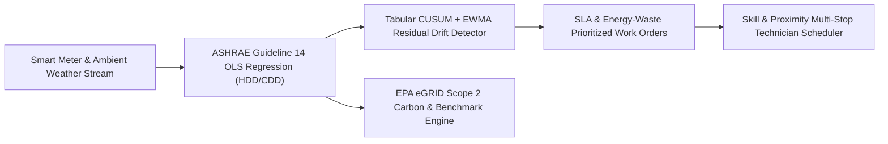

# UtiliTrack — Commercial Real Estate Energy Telemetry & SLA Maintenance Dispatch

[](https://github.com/aazminu/utilitrack-cbre/actions)
[](https://opensource.org/licenses/MIT)
[](https://abdullahazmi.com)

**UtiliTrack** is a building energy telemetry, weather-normalized Energy Use Intensity (EUI) regression, equipment degradation detection, and SLA-constrained technician work-order dispatch engine developed for commercial real estate portfolios (**1st Place CBRE Challenge & 3rd Place Overall @ HackUNT 2024**).

---

## Core Architecture



### 1. Weather-Normalized EUI Regression (`utilitrack.telemetry`)
Commercial HVAC plants exhibit strong non-linear dependence on ambient dry-bulb temperature. UtiliTrack fits a multi-parameter degree-day change-point model following **ASHRAE Guideline 14**:

$$\text{EUI}_t = \beta_0 + \beta_c \cdot \text{CDD}(T_t) + \beta_h \cdot \text{HDD}(T_t)$$

where $\text{CDD}(T) = \max(0, T - T_{\text{base}})$ and $\text{HDD}(T) = \max(0, T_{\text{base}} - T)$ relative to a configurable balance-point temperature (default $65^\circ\text{F}$).

### 2. CUSUM & EWMA Equipment Degradation Detection (`utilitrack.telemetry`)
Stuck economizer dampers, fouled chiller condenser tubes, and simultaneous heating/cooling manifest as persistent positive drift in weather-normalized residuals $z_t = (y_t - \hat{y}_t)/\sigma$. UtiliTrack tracks both:
- **Two-Sided Tabular CUSUM:** $S_t^+ = \max(0, S_{t-1}^+ + z_t - k)$ and $S_t^- = \max(0, S_{t-1}^- - z_t - k)$
- **Exact Finite-Horizon EWMA:** $Z_t = \lambda z_t + (1 - \lambda) Z_{t-1}$ normalized by $\sigma_{Z_t} = \sqrt{\frac{\lambda}{2-\lambda}\left(1 - (1-\lambda)^{2t}\right)}$

### 3. EPA eGRID Scope 2 Carbon Accounting (`utilitrack.telemetry`)
Translates interval and annual kilowatt-hour consumption into Scope 2 $\text{CO}_2\text{e}$ metric tons across regional EPA eGRID subregions (`ERCT`, `CAMX`, `RFCW`, `SRMV`, `NYUP`, `US_AVG`) and benchmarks building EUI against **ASHRAE Standard 100** targets.

### 4. SLA-Constrained Technician Dispatch (`utilitrack.scheduler`)
Ranks BMS fault tickets and tenant work orders by combining severity weight, inverse SLA time-to-breach urgency, and continuous energy waste ($\text{kW}$), then routes multi-stop field technicians by minimizing travel distance, workload imbalance, and SLA violation risk.

---

## Quick Start

```bash
pip install -e ".[dev]"
pytest -v
```

```python
from utilitrack import (
    MeterReading,
    Technician,
    WorkOrder,
    detect_equipment_drift,
    dispatch_work_orders,
    fit_weather_normalized_eui,
)

# 1. Fit weather-normalized EUI baseline on 100,000 sq.ft commercial office
readings = [
    MeterReading("2024-07-01T14:00:00Z", kwh=2000.0, outdoor_temp_f=65.0),
    MeterReading("2024-07-02T14:00:00Z", kwh=3500.0, outdoor_temp_f=75.0),
    MeterReading("2024-07-03T14:00:00Z", kwh=5000.0, outdoor_temp_f=85.0),
    MeterReading("2024-07-04T14:00:00Z", kwh=2800.0, outdoor_temp_f=55.0),
]
baseline = fit_weather_normalized_eui(readings, gross_floor_area_sqft=100_000.0)

# 2. Dispatch highest-priority HVAC work orders to field engineers
orders = [
    WorkOrder(
        order_id="WO-401",
        asset_id="CHILLER-02",
        required_skill="hvac",
        severity="CRITICAL",
        sla_hours_remaining=1.5,
        location_xy=(4.2, 8.1),
        estimated_duration_hours=2.0,
        est_energy_waste_kw=38.5,
    )
]
techs = [
    Technician(
        tech_id="TECH-01",
        name="Marcus Vance",
        skills=frozenset({"hvac", "controls"}),
        current_xy=(3.8, 7.9),
        available_hours=8.0,
    )
]
plan = dispatch_work_orders(orders, techs)
print(plan.assignments[0])
```

---

## Author

**Abdullah Azmi** — Northwestern University (`m4u5t4@u.northwestern.edu`)  
Portfolio: [https://abdullahazmi.com](https://abdullahazmi.com) • GitHub: [@aazminu](https://github.com/aazminu)


## CLI Diagnostics & Invariant Verification

Run the built-in deterministic diagnostic probe and invariant self-check directly via the module CLI:

```bash
PYTHONPATH=src python -m utilitrack --self-test --json
```

Run the complete regression test suite:

```bash
PYTHONPATH=src pytest -q
```
